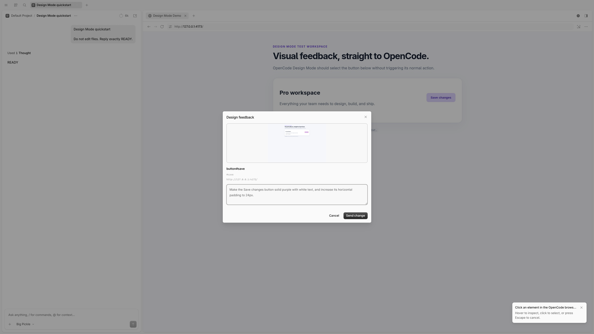
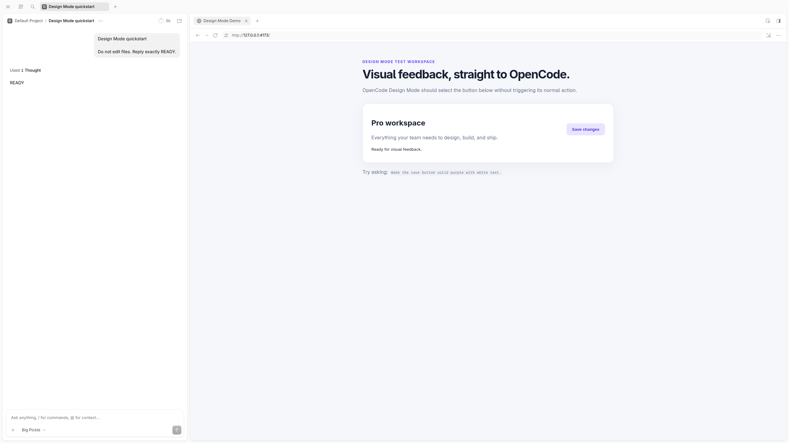
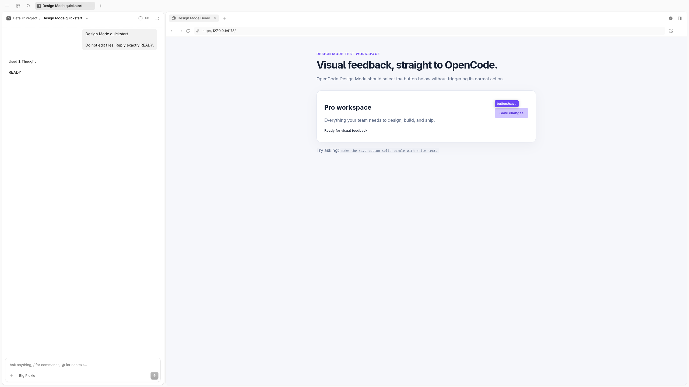
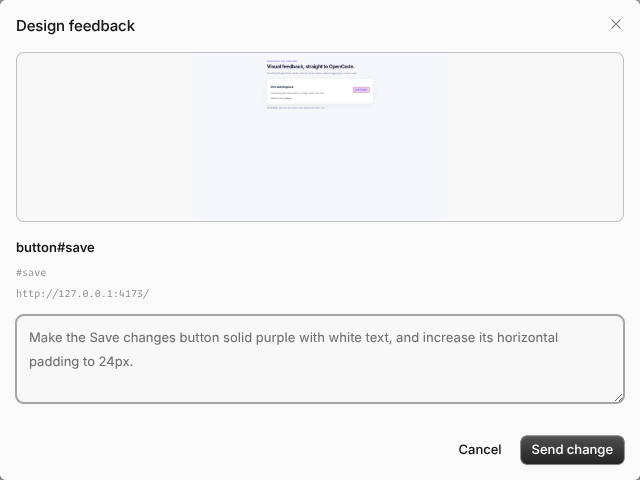

# Design Mode for OpenCode

**Point at the UI. Describe the change. Let OpenCode edit the source.**

Design Mode adds Cursor-style visual feedback to **OpenCode Desktop**. Select an element in the built-in browser, write what should change, and send your request with a highlighted screenshot and the element's technical context—without copying selectors, HTML, or screenshots into chat by hand.

[](https://opencode.ai)
[](LICENSE)
[](https://opencode.ai/docs/build/plugins/gui)



## Contents

- [Why Design Mode?](#why-design-mode)
- [Installation](#installation)
- [Quickstart](#quickstart)
- [Try the included demo](#try-the-included-demo)
- [Write better visual prompts](#write-better-visual-prompts)
- [What OpenCode receives](#what-opencode-receives)
- [Privacy](#privacy)
- [Troubleshooting](#troubleshooting)
- [Development](#development)
- [Current limitations](#current-limitations)

## Why Design Mode?

Visual changes are often easier to show than to explain. Design Mode keeps the entire feedback loop inside OpenCode:

- **Point instead of search.** Hover to inspect an element, then click to select it.
- **Keep the page safe.** The selection click does not activate links, buttons, or forms.
- **Show the exact state.** A native screenshot captures the page with your target outlined.
- **Provide useful context.** OpenCode receives the selector, XPath, trimmed HTML, computed CSS, viewport geometry, and available React/Vue component hints.
- **Stay in your workflow.** Feedback goes to the current session, using the model and variant selected in OpenCode's composer.
- **Edit real source.** The agent is asked to update project files and verify the result, not leave a DOM-only preview.

Design Mode is inspired by the Agent-mode interaction in the sibling Arbora project, adapted for OpenCode's native GUI plugin and session APIs.

## Installation

### Requirements

- **OpenCode Desktop 2.2.7 or later.** The GUI plugin API is experimental.
- The built-in **OpenCode Browser** panel.
- An app running at an `http://`, `https://`, or allowed `file://` URL.
- A **vision-capable model** if you want the agent to interpret the screenshot. Text-only models can still use the element metadata.

Design Mode has been verified on Linux with OpenCode Desktop 2.2.7. macOS and Windows use the same OpenCode/Electron APIs but have not yet been verified.

### Install from GitHub

Run:

```bash
opencode plugin add github:maplepreneur/opencode-design
```

Then open **Settings → Extensions → Plugins** in OpenCode Desktop and make sure **Design Mode** is enabled. If the plugin appears in a failed state, choose **Reload** after confirming your OpenCode version.

To update an existing installation:

```bash
opencode plugin update
```

<details>
<summary>Prefer to edit your config manually?</summary>

Add the GitHub package to the `plugins` array in your global `~/.config/opencode/opencode.json(c)`, preserving any plugins you already have:

```jsonc
{
  "$schema": "https://opencode.ai/config.json",
  "plugins": ["github:maplepreneur/opencode-design"]
}
```

OpenCode Desktop reads GUI plugins from this global config.

</details>

## Quickstart

### 1. Open your app in OpenCode's Browser

Start your app's development server as usual, for example:

```bash
npm run dev
```

In an OpenCode session, open the command palette and run **Open browser**. Paste your app's URL, such as `http://localhost:3000`, and press **Enter**.



### 2. Start Design Mode

Use any of these entry points:

- Click **Start visual feedback** at the end of the Browser panel's tab strip.
- Run **Design Mode: Start visual feedback** from the command palette.
- Press **Ctrl + Shift + D** on Windows/Linux or **Cmd + Shift + D** on macOS.

### 3. Select the element to change

Hover over the page to inspect elements. A purple outline and label identify the current target. Click once to select it; the normal button or link action is not triggered.

Press **Escape** if you want to cancel instead.



### 4. Describe the change and send it

The feedback popup shows the screenshot, selected element, selector, and page URL. Write the outcome you want, then click **Send change**.

- **Enter** submits your feedback.
- **Shift + Enter** inserts a newline.
- **Cancel** discards the selection without sending anything.



OpenCode submits the prompt and screenshot to the current session. Review the proposed diff as you normally would, then check the updated app after hot reload.

## Try the included demo

Want to test the workflow before pointing it at your own app? Clone the repository and serve the included demo:

```bash
git clone https://github.com/maplepreneur/opencode-design.git
cd opencode-design
python3 -m http.server 4173 --bind 127.0.0.1 --directory demo
```

Open **http://127.0.0.1:4173** in OpenCode's Browser, select **Save changes**, and try:

> Make the Save changes button solid purple with white text, and increase its horizontal padding to 24px.

The demo's normal button action reports whether it ran, which also makes it useful for verifying that Design Mode intercepts selection clicks correctly.

## Write better visual prompts

A good visual prompt names the desired outcome, not just the element. Small, focused requests are easiest to review.

| Goal | Example prompt |
| --- | --- |
| Restyle an element | “Make this the primary action: solid purple background, white text, and 24px horizontal padding.” |
| Fix alignment | “Vertically center this button with the heading, and keep the current 20px gap.” |
| Match an existing pattern | “Make this card use the same radius, border, and padding as the cards below it.” |
| Improve responsiveness | “On narrow screens, stack this row with the button full width below the text.” |
| Clarify content | “Change this label to ‘Save subscription’ and keep the existing button styles.” |
| Compare references | “Use the spacing from the selected heading as the reference for this section.” |

**Tip:** Choose a vision-capable model for screenshot-based requests. Design Mode applies the model and variant currently selected in OpenCode's composer when it submits your feedback.

## What OpenCode receives

Each submitted request contains:

| Context | Purpose |
| --- | --- |
| Your written request | Describes the change to make. |
| Highlighted screenshot | Shows the page state and the selected element's spatial context. |
| Page URL, title, and viewport | Identifies where the capture came from. |
| CSS selector and XPath | Helps locate the target in source or browser tools. |
| Trimmed HTML, text, classes, and computed CSS | Describes what is currently rendered. |
| Component chain and source hints | Uses React/Vue development metadata when available. |
| Element geometry | Describes the target's border box and device pixel ratio. |

The agent is instructed to find the real source, follow the project's conventions and design tokens, verify the result when browser tools are available, and summarize its changes.

## Privacy

Design Mode only injects the inspector when you start it. It captures a screenshot **after you select an element**, and sends the screenshot and element context to your configured model provider **only when you submit the feedback**.

The screenshot may include anything visible in the browser viewport. Review the preview before sending, and avoid submitting pages that contain secrets, personal data, or confidential information.

## Troubleshooting

| Problem | What to try |
| --- | --- |
| **“Open a web page in OpenCode's Browser panel…”** | Open the Browser panel, load your app, select its tab, then start Design Mode again. |
| **Design Mode cannot find the page** | Run **Design Mode: Browser diagnostics** to see the native browser views available to the plugin. |
| **The Browser or Design Mode launcher is missing** | Widen the OpenCode window. OpenCode hides some side-panel launchers in its narrow layout, and commands are session-scoped. |
| **The model says it cannot read images** | Switch to a vision-capable model in OpenCode's composer and submit again. The selector, HTML, and CSS context still works with text-only models. |
| **The command does not appear** | Confirm the plugin is enabled under **Settings → Extensions → Plugins**, use OpenCode Desktop 2.2.7+, and check that a session is open. |
| **No exact component source is reported** | Source locations depend on development metadata exposed by your framework. The selector, HTML, styles, and component names are still included. |
| **An iframe element cannot be selected** | Cross-origin iframe contents and closed shadow roots are not currently inspectable. Select an element in the top-level page instead. |
| **The screenshot contains sensitive content** | Cancel the popup. Nothing is sent to the model until you choose **Send change**. |

If you get stuck, [open an issue](https://github.com/maplepreneur/opencode-design/issues) with your OpenCode version, operating system, app framework, and the result from **Design Mode: Browser diagnostics**. Remove private URLs and screenshot data first.

## Development

### Local setup

```bash
git clone https://github.com/maplepreneur/opencode-design.git
cd opencode-design
npm install
npm run build
```

Add the absolute checkout path to your global `~/.config/opencode/opencode.json(c)`:

```jsonc
{
  "$schema": "https://opencode.ai/config.json",
  "plugins": ["/absolute/path/to/opencode-design"]
}
```

Run the watcher while developing. OpenCode Desktop reloads the GUI after each build:

```bash
npm run dev
```

### Verify changes

```bash
npm run check
```

That command runs TypeScript checks, prompt/attachment unit tests, real Chromium interaction tests, and the production GUI build. You can also run each step separately:

```bash
npm run typecheck
npm run test
npm run test:e2e
npm run build
```

Chromium tests use `/usr/bin/chromium` by default. Set `CHROMIUM_PATH` to use another Chromium executable.

The plugin has also been exercised end to end in OpenCode Desktop through native element selection, screenshot capture, popup submission, model switching, inline-image delivery, and a successful vision-model response.

### Project map

- `src/browser/inspector.ts` — page overlay, selection, DOM metadata, and framework hints.
- `src/gui/main.ts` — Electron browser discovery, native screenshots, resizing, and lifecycle.
- `src/gui/window.tsx` — commands, side-panel action, popup, model selection, and session delivery.
- `src/gui/contract.ts` — typed Effect Schema IPC between the window and main process.
- `src/shared/prompt.ts` — deterministic prompt and inline-image attachment construction.

Contributions and issue reports are welcome at [maplepreneur/opencode-design](https://github.com/maplepreneur/opencode-design).

## Current limitations

- Cross-origin iframe contents and closed shadow roots cannot be inspected.
- Exact component source locations depend on framework development metadata.
- Models without image support cannot interpret the screenshot, although they still receive the textual context.
- Design Mode requests source changes through OpenCode; it does not directly edit styles or files itself.
- OpenCode's GUI plugin API is experimental, so future releases may require adapter updates.

## License

[MIT](LICENSE) — use it, adapt it, and share it.
